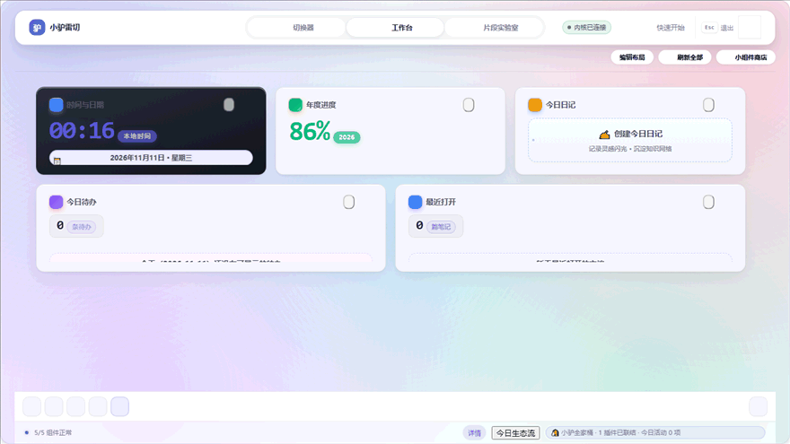

# Lv Speed Switch (小驴雷切)

  

**What problem does Lv Speed Switch solve?**
When working with dozens of opened tabs and multiple projects in SiYuan Note, heavy knowledge workers face five constant pain points: **losing track of open tabs, struggling to recover accidentally closed workspace contexts, lacking a glanceable dashboard, scattering cross-document excerpts, and risking host stability when tweaking custom CSS/JS**.

**Lv Speed Switch** is a **local-first unified switcher and work-context platform** for SiYuan Note ([Interface Map](docs/interface-map.svg) · [Architecture Diagram](docs/architecture.svg)). It connects **core productivity surfaces**—the Switcher (Surface 1), Bento Widget Workbench (Surface 2), Snippet Studio (Surface 3), and an intelligent Floating Action Button (FAB)—so you can find, preview, switch, capture, and restore your work context in under a second.

> **Latest stable release: v0.48.90 (2026-11-13 · Local Verified)** · [中文文档](./README.md) 
> Minimum Supported Host Version: **SiYuan Note v3.8.4+** (Desktop, Sidebar Dock & Mobile)

  

---

## What's New In v0.48.90 (2026-11-13 · Local Verified)

- **SiYuan 3.8.10+ Native Adaptations**: Switcher document hits support Shift+right-click / Shift+F10 to open native document tree context menus with SQL notebook resolution fallback; search card titles preserve slashes safely (`safeDocTitleFromHPath`); Action Palette supports toggling native SiYuan docks.
- **Input Method & Clipboard Resilience**: Settings name creation, dialogs, and rename inputs yield during IME composition (contract-tested); Snippet Stack copy failure accurately reports `copyFailed`; Launchpad keyboard navigation yields to IME (ECO-015).
- **Responsive Layout & Accessibility Polish**: Module action labels enforce `overflow: hidden` and `white-space: nowrap` for working ellipsis; desktop hover affordances wrapped in `@media (hover: hover)`; smooth-scroll reduced-motion, i18n parity, and clipboard error-handling contracts enforced.
- **Budget & Token Conformance**: ADR 0559 archive 784 KiB / compressed 418 KiB recalibration with font/radius token alignment.

View Previous Release Highlights (v0.48.88 and earlier · Full history in <a href="./CHANGELOG.md">CHANGELOG.md</a>)

- **v0.48.88 (2026-11-04)**: Integrated all 7 Lv ecosystem pillars, Surface 1 Activity Stream toolbar & footer status pill, modal Escape focus-stack hardening, Snippet Stack AI synthesis, and 30 real-host isolated E2E tests.
- **v0.48.87 (2026-11-01)**: Second Panel Apple Bento 3.0 / Liquid Glass 3.0 Overhaul, Organic WidgetKit Composition, Widget Store 100% Visually Unified with golden size recommendations, 9 host linkages and 12 ecosystem bridges verified.
- **v0.48.86 (2026-11-01)**: 286-element full inventory audit at 100% coverage, 17 stock defects resolved (B-01~B-17), snippet store "💎 Featured Gems" premier view with 10 LianDi community CSS masterpieces, sandbox iframe 11-category hero probes, and reading rail truncation fix.
- **v0.48.85 (2026-10-31)**: Snippet Stack end-to-end wiring, selection snapshot persistence, one-click Undo restoration, and single-source version governance.
- **v0.48.84 (2026-10-30)**: Full-surface Bento dual-layer canvas and floating white cards (`--sw-shadow-bento`), cross-surface reactive metrics bar, strict two-tone color separation (`--sw-color-accent` vs. `--sw-color-data`), and stepped Escape query clearing.
- **v0.48.83 (2026-10-29)**: Snippet Studio dynamic import error recovery, unified `activeDialogs` teardown on `onunload`, modal focus trapping (`trapDialogFocus`), and input debounce optimization.
- **v0.48.80 ~ v0.48.82 (2026-10-29)**: Widget card `F/C/M` keyboard shortcuts and long-press context menu, UserCSS `@var` validation, and 76 built-in curated CSS snippets.
- **v0.48.0 ~ v0.48.79 (2026-10-20 ~ 2026-10-29)**: Deep penetration search (`@/:` headings, `^` blocks, `#` tags, `!` bookmarks, `-` tasks, `>` commands, `?` CheatSheet), secondary Action Palette (`Ctrl+K` / `⌘K`), AV board & flashcard widgets, and 4 Workbench scene presets.

---

## 📦 Installation & Upgrade

1. **SiYuan Marketplace (Recommended)**: Open SiYuan `Settings` → `Marketplace` → `Plugins`, search for **"Lv Speed Switch"** (or **小驴雷切**), click Install, and enable it;
2. **Manual Offline Installation**: Download `package.zip` (from Releases or local build output) and extract it to `<workspace>/data/plugins/siyuan-speed-switch/`, then enable the plugin in `Settings` → `Plugins`;
3. **Safe Upgrade & Rollback**: Export a full Config Pack backup in plugin `Settings` → `Storage` anytime. All user data lives under `data/storage/petal/siyuan-speed-switch/` and remains intact across upgrades or rollbacks.

---

## ⚡ 3-Step Quick Start

1. **Invoke**: Press `Alt + Shift + S` (`Option + Shift + S` on macOS) or click the topbar icon to open Surface 1 (Switcher);
2. **Search**: Type document titles, keywords, or Pinyin initials, or click the mode pills (`@Outline`, `^Block`, `#Tag`, `!Bookmark`, `-Task`) for deep penetration search;
3. **Act & Capture**: Press `Enter` to jump to the target note, press `Ctrl+K` (or `⌘K`) to open the Action Palette, or select text in the editor and trigger "Capture Selection to Stack" from the Floating Ball!

---

## 🌟 Four Work Surfaces & Key Features

| Surface | Core Purpose | Form Factors & Capabilities |
| :--- | :--- | :--- |
| **Surface 1: Switcher** | **Where to go**: Instant filtering of open tabs, favorites, recently closed notes, and deep block search with a 34% reading preview pane. | Fullscreen/Adaptive Dialog, Right Sidebar Dock, Mobile Sheet; Pinyin initials, path acronym scoring, penetration search, and Action Palette. |
| **Surface 2: Workbench** | **Where to look**: Bento-style glanceable dashboard with 58 customizable widgets ([Component Store Guide](docs/component-store-guide.md)). | 12-column responsive grid; 4 scene presets, in-place todo checkbox toggling, undo/redo layout history, health diagnostics, and isolated retry. |
| **Surface 3: Snippet Studio** | **What to customize & collect**: Sandboxed CSS/JS snippet manager (76 built-in snippets) paired with AI assistant and **Sequential Snippet Stack**. | Desktop studio (with standalone Snippet Stack dialog on mobile/sidebar); line numbers, bracket diagnostics, zero-dep CSS formatter, recycle bin, TextFold 5-level slicing, and batch assembly. |
| **Trigger: Floating Ball (FAB)** | **Everywhere accessible**: Edge-docked global trigger on desktop and mobile that promotes context-aware actions based on active editor selection. | Free placement or edge snap, 4-way flick gestures, single/double-tap/long-press bindings, 1–9 digit slots, and mobile swipe isolation (`data-prevent-swipe`). |

### Feature Highlights
1. **Deep Penetration Search & Secondary Action Palette (`Ctrl+K` / `⌘K`)**:
   - Prefix routing for `:heading` (or `@heading`), `^block`, `#tag`, `!bookmark`, `-task`, `>command`, and `?` symbol navigation CheatSheet guide; click an active mode pill again to reset the prefix;
   - Press `Ctrl+K` or `⌘K` on any item to open the Action Palette for right/bottom split opening, block link/Markdown link copying, saving open tabs as a Document Set, or exporting an outline mindmap;
   - **Stepped Escape**: First `Esc` clears query text while keeping the mode prefix, second `Esc` clears the prefix, and third `Esc` closes the dialog.
2. **Sequential Snippet Stack & TextFold 5-Level Slicing**:
   - Capture multi-document selections into a bounded 32-slot stack with multi-fragment tabs (`Raw Fragment`, `Key Insights`, `Action Items`) and verbatim `((blockId "anchor"))` backlinks;
   - Reorder with `Alt+↑/↓`, edit inline with `F2`, pin important slices, undo accidental removals/clears, and batch-assemble into today's journal, active editor, a new document, or clipboard.
3. **Named Document Sets & Controlled Agent Context**:
   - Snapshot all open tabs into named Document Sets with active-tab focus memory, 3-revision history, pre-restore availability checks, and Markdown restore reports;
   - Exposes bounded read-only workspace and document context capabilities ([Agent Document Context Contract](docs/agent-document-context-m2.md)).

---

## ⌨️ Shortcut Reference

| Windows / Linux | macOS | Scope | Action |
| :--- | :--- | :--- | :--- |
| `Alt + Shift + S` | `Option + Shift + S` | Global (customizable in SiYuan Keymap) | Open Surface 1 (Switcher) |
| `Alt + Shift + P` | `Option + Shift + P` | Global (supports OS-wide global hotkey) | Open Surface 2 (Workbench) |
| `Ctrl+K` or `⌘K` | `Cmd+K` or `⌘K` | Switcher card / search item | Open Secondary Action Palette for focused item |
| `Shift+F10` | `Shift+F10` | Switcher card | Open context menu for focused card |
| `Ctrl+Shift+T` | `Cmd+Shift+T` | Switcher / Action Palette | Undo close and restore the most recently closed tab |
| `Alt+R` | `Option+R` | Switcher | Refresh data sources and search results |
| `Ctrl+Shift+S` / `⌘⇧S` | `Cmd+Shift+S` / `⌘⇧S` | Action Palette | Save currently opened tabs as a new Document Set |
| `Alt + C` | `Alt + C` | Switcher search item | Copy `siyuan://` block link to clipboard |
| `Alt + S` | `Option + S` | Action Palette | Capture selection or focused item into Snippet Stack |
| `Home` / `End` / `PgUp` / `PgDn` | `Home` / `End` / `PgUp` / `PgDn` | Switcher / Workbench | Jump to first/last card or navigate by page |
| `1 ~ 9` | `1 ~ 9` | Switcher / FAB drawer | Activate candidate 1 through 9 directly |
| `Ctrl + S` | `Cmd + S` | Snippet Studio | Save current snippet draft |
| `Ctrl + Z` / `Ctrl + Y` | `Cmd + Z` / `Cmd + Shift + Z` | Snippet Studio editor | Undo / Redo code edits |
| `Esc` | `Esc` | Any surface / modal | Stepped query clear / blur editor / close active modal |

---

## ⚙️ Settings Overview (10 Configuration Panels)

| Panel | Core Options | Default | Impact & Behavior |
| :--- | :--- | :---: | :--- |
| **1. Appearance** | Skin palette, density (Comfortable / Compact), Reduced Motion | `Host Theme / Comfortable` | Switch skins in real time and disable animations when Reduced Motion is enabled. |
| **2. Behavior** | Pinyin match, reuse open tabs, auto-snapshot on switch | `Enabled` | Controls CJK Pinyin matching, tab deduplication, and scroll/cursor restoration. |
| **3. Panels** | Surface size modes (Fullscreen / Adaptive / Custom), thumbnails, module visibility | `Fullscreen / Enabled` | Configure window dimensions per surface and toggle module entry visibility. |
| **4. Favorites** | Favorite groups, renaming, ordering, and dynamic smart groups | `Ungrouped` | Organize favorite notes into collapsible groups and query-driven smart folders. |
| **5. Quick Actions** | Toolbar action assignment and ordering per surface (Desktop / Sidebar / Mobile) | `Per-surface preset` | Customize topbar/bottom-bar quick actions while keeping Journal directly reachable. |
| **6. Floating Ball** | Desktop/Mobile switches, edge snap, tap/double-tap/long-press/flick bindings, 1–9 slots | `Enabled` | Live-preview and bind gestures, appearance, and versioned JSON import/export. |
| **7. Document Sets** | Create, overwrite, rename, diff history, restore preview, Essentials auto-open | `On-demand` | Manage workspace tab snapshots with JSON backup and Markdown restore reports. |
| **8. Journal** | Default journal notebook selection and creation behavior | `Prompt on first use` | Target notebook for daily notes, today's tasks, and Snippet Stack journal assembly. |
| **9. Mobile** | Card columns (Single / Double / Auto), mobile thumbnail height (48–200px) | `Auto / 80px` | Enforces ≥44px touch targets and safe-area insets on mobile screens. |
| **10. Storage** | Usage bars for 18 storage keys, schema health, Config Pack import/export | `Local storage` | Inspect storage quota, migration health, and apply selective Config Pack restores. |
---

## ❓ Frequently Asked Questions (FAQ)

### Q1: Why does pressing `Ctrl+P` open SiYuan's built-in search instead of Lv Speed Switch?
- **Answer**: To avoid conflicting with SiYuan's native global search (`Ctrl+P`), Lv Speed Switch uses **`Alt + Shift + S`** (`Option + Shift + S` on macOS) for the Switcher and **`Alt + Shift + P`** for the Workbench by default. You can customize any shortcut in SiYuan `Settings` → `Keymap` → `Plugin`.

### Q2: How do I search un-opened documents or specific headings and paragraphs across my workspace?
- **Answer**: Typing a plain keyword immediately filters open tabs first, then progressively queries open document contents and workspace document titles. To penetrate directly into block contents or headings, prefix your query with `^keyword` or `:heading` (or click the `@Outline`, `^Block`, `#Tag`, `!Bookmark`, `-Task` pills).

### Q3: Does clicking the Floating Ball clear my current text selection before capturing to the Snippet Stack?
- **Answer**: No. v0.48.85 caches active `.protyle-wysiwyg` editor selections along with the paragraph's `data-node-id` before focus moves to the FAB or Switcher dialog, ensuring accurate slice capture and `((blockId "anchor"))` backlinks. Accidental removals or clears can be undone with one click via the **Undo** button.

### Q4: Will dragging the Floating Ball on mobile accidentally trigger SiYuan's native sidebar swipe?
- **Answer**: No. All mobile portals and sheets declare `data-prevent-swipe="true"` with an 8px touch slop classifier so plugin gestures never leak into the host's edge-swipe handler.

---

## 🔒 Privacy & Local-First Commitment

- **100% Local-First**: All core features execute locally inside your SiYuan workspace (`data/storage/petal/siyuan-speed-switch/`). No telemetry, no analytics servers, and no note uploads.
- **Transparent Optional Widgets**: External widgets (Open-Meteo weather, Bangumi calendar, news feeds) only issue read-only requests when explicitly added to your Workbench ([Component Store Guide](docs/component-store-guide.md)).

---

## 🛠️ Release Checklist & Verification

The project enforces strict local-first verification and a comprehensive Release Checklist:
- Run `pnpm run verify:release` for TypeScript type checks, reproducible dual-build audits, unit/contract tests, and smoke tests;
- The test runner automatically discovers all `*.test.cjs` files across the repository;
- Production build output includes `dist/` and the offline archive `package.zip`;
- Host compatibility verification across desktop and mobile platforms (browser emulation is a structural smoke test, not Android acceptance);
- Formal published candidate builds must satisfy all offline gating tests and retain the previous rollback archive before sealing.

> The current version is `v0.48.90`
