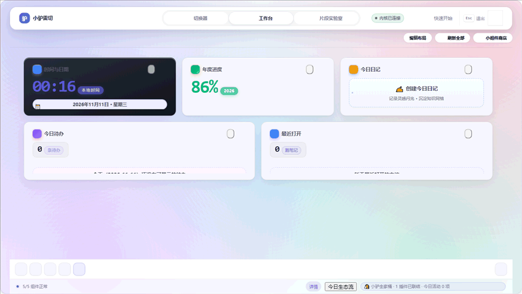

# 小驴雷切 · Lv Speed Switch

**专为思源笔记打造的本地优先统一切换与工作上下文平台**

全能切换器 · Bento 小组件工作台 · 代码片段实验室 · 全局智能悬浮球 · 连续切片暂存栈

**当前版本：v0.48.90** ｜ 最近正式版：v0.48.90（2026-11-13 · 本地封验） ｜ [English Documentation](./README.en-US.md) ｜ [更新日志](./CHANGELOG.md)

[⬇️ 安装方式](#-安装方式installation) · [🚀 快速上手](#-三步快速上手quick-start) · [🖥️ 面板指南](#-四大工作入口与功能说明) · [⚙️ 设置参考](#-设置项说明10-大配置面板) · [⌨️ 快捷键](#-常用快捷键一览表) · [🔒 隐私说明](#-隐私与本地优先说明)

 

---

## 🎯 为什么需要小驴雷切？它解决什么问题？

当你在思源笔记中打开十几个页签、在多个项目间频繁穿插、需要跨文档摘录重点或安全调试自定义样式时，往往面临**“页签找不着、误关难找回、缺乏全局工作台概览、跨文档摘录零散、CSS 调试容易破坏宿主”**五大痛点：

| 痛点场景 | 原生思源 / 传统操作局限 | 小驴雷切解决方案 |
| :--- | :--- | :--- |
| **页签堆积，找不着也回不去** | 打开十几个页签后标题被挤成缩略图标，误关后想找回历史难如登天 | **第一面板 · 全能切换器**：汉字全拼/简拼秒级检索，大纲正文双栏即时预览，`Ctrl+Shift+T` 一键撤销找回 |
| **缺乏一眼扫清全局的早晨大盘** | 打开思源直接面对空白文档，今日待办、打卡、日记与系统状态散落在各处 | **第二面板 · Bento 工作台**：58 款精致小组件，自由编排看板、今日待办原地勾选、打卡数据与日记聚合 |
| **跨文档多处摘录难以整合** | 读多篇长文做调研，不断来回切文档复制粘贴，打断阅读与思考心流 | **连续切片暂存栈（Snippet Stack）**：划选即存，保留原文血缘反链，多切片一键融合编织进日记或新文档 |
| **自定义 CSS/JS 易崩溃白屏** | 在思源调试样式一旦写错整站白屏，甚至无法打开设置撤销修改 | **第三面板 · 片段实验室**：独立 iframe 沙箱隔离预览，行号语法诊断，一键开关，内置 76 款名家精选样式 |
| **全天候高频操作无处安放** | 常用操作藏在层层多级菜单里，鼠标需频繁长途移动寻找按钮 | **全局智能悬浮球 (FAB)**：主窗口与移动端边缘贴靠，自动识别正文选区动态置顶匹配动作，四向滑动手势绑定 |

---

## 🌟 四大工作入口与功能说明

| 入口表面 | 解决的核心问题 | 支持形态与核心能力 |
| :--- | :--- | :--- |
| **第一面板：切换器 (Switcher)** | **“去哪儿”**：毫秒级检索已开页签、收藏、最近关闭与全库内容，右侧 34% 独立阅读窗格实时预览大纲与正文。 | 桌面全屏/自适应弹窗、右侧栏 Dock、移动端 Sheet；支持汉字全拼/简拼、路径首字母缩写、多模态穿透与次级动作画板。 |
| **第二面板：工作台 (Workbench)** | **“看什么”**：现代 Bento 瓷贴看板，自由编排 58 款实用小组件（[组件来源指南](docs/component-store-guide.md)），扫一眼掌握今日待办、日记、统计与打卡进度。 | 12 列响应式网格；支持 4 套场景预设、今日待办原地勾选写回、拖拽重排撤销/重做、组件健康诊断与单卡隔离重试。 |
| **第三面板：片段实验室 (Studio)** | **“改什么 & 攒什么”**：左中栏安全管理与沙箱预览 CSS/JS 片段（内置 76 款精选片段）；右栏集成 AI 伴侣与**连续切片暂存栈**。 | 桌面工作台（移动端/侧栏端支持独立暂存栈弹窗）；支持行号/括号诊断、零依赖 CSS 格式化、回收站版本自愈、TextFold 5 阶语义切片与一键组装导出。 |
| **全局触发器：悬浮球 (FAB)** | **“随处可达”**：主窗口与移动端全局边缘吸附，识别当前正文选区特征动态置顶最匹配的快捷动作。 | 支持自由停放/贴边半隐、四向快滑手势绑定、单击/双击/长按独立映射、1–9 数字固定槽与移动端防宿主侧滑冲突（`data-prevent-swipe`）。 |

### 核心特性详解
1. **深入穿透检索与次级动作画板（Action Palette）**：
   - 支持 `:标题`（或 `@标题`）大纲穿透、`^正文块` 块级穿透、`#标签`、`!书签`、`-待办`、`>命令` 及 `?速查` 符号导航速查指引，点击已激活药丸可二次点击反选重置；
   - 在任意卡片或结果项上按 `Ctrl+K` 或 `⌘K` 呼出次级动作画板，支持右侧/下方分屏打开、复制块超链/Markdown 引用、将当前打开页签保存为文档集、导出大纲思维导图；
   - 搜索框支持**两阶梯智能 Escape 回退**：首按 Esc 清空关键词保留模式前缀，再按清空前缀回全量，第三次按 Esc 关闭窗口。
2. **连续切片暂存栈（Snippet Stack）与 TextFold 5 阶语义切片**：
   - 在阅读多篇笔记时，选中文本触发「原子切片入栈」，自动提取概念标题、核心提炼与行动项三维分片，并绑定来源段落 `((blockId "锚点"))` 血缘反链；
   - 支持置顶锁定（Pin）、`Alt+↑/↓` 调序、`F2` 行内微调、删除/清空后一键撤销（Undo），以及按选定维度一键组装推入今日日记、插入当前文档、生成新文档或复制 Markdown。
3. **命名文档集（Document Sets）与 Agent 受控能力**：
   - 将当前工作区所有打开页签保存为命名文档集（保留活动页签焦点标记与最多 3 版覆盖历史），恢复前自动预检缺失项并支持导出恢复报告；
   - 提供只读工作区与文档上下文协议（[Agent 上下文契约说明](docs/agent-document-context-m2.md)）。

---

## ⚡ 三步快速上手（Quick Start）

1. **一键呼出**：在思源笔记任意界面按下默认快捷键 `Alt + Shift + S`（macOS 为 `Option + Shift + S`）或点击顶栏雷切图标唤出第一面板切换器；
2. **极速检索**：输入文档标题、关键词或拼音首字母简拼（如输入 `yj` 匹配“研究规范”），或点击顶栏多模态药丸（`@大纲`、`^正文块`、`#标签`、`!书签`、`-待办`）深入全库检索；
3. **秒级动作**：按 `Enter` 直接切换文档，按 `Ctrl+K`（或 `⌘K`）呼出次级动作画板分屏打开，或在正文选中文本后通过悬浮球一键将原子切片收入暂存栈！

---

## 📦 安装方式（Installation）

1. **思源集市安装（推荐）**：打开思源笔记 `设置` → `集市` → `插件`，搜索 **「小驴雷切」**（或 `siyuan-speed-switch`）点击下载并启用；
2. **离线安装包手动安装**：获取发行归档包 `package.zip`（见 Releases 或本地构建产物），解压至思源工作空间下的 `data/plugins/siyuan-speed-switch/` 目录，在思源 `设置` → `插件` 中开启开关即可生效；
3. **升级与安全回退**：升级前可在插件 `设置` → `数据与存储` 中一键导出完整配置备份包（Config Pack）；插件所有用户数据均保存在工作区 `data/storage/petal/siyuan-speed-switch/` 下，停用或覆盖升级不会丢失已有收藏、文档集与布局配置。

> 最低宿主版本：**思源笔记 v3.8.4+**（桌面端 / 侧栏 Dock / 移动端全平台支持，包括 Android 与 iOS）。

---

## ⚙️ 设置项说明（10 大配置面板）

在切换器/工作台右上角点击「设置」齿轮或在命令面板执行「打开小驴雷切设置」，即可通过顶部搜索框跨 10 个分组检索配置：

| 设置分组 | 核心设置项 | 默认值 | 说明 |
| :--- | :--- | :---: | :--- |
| **1. 外观 (Appearance)** | 皮肤模式、界面密度（舒适/紧凑）、减弱动态效果 | `融合主题 / 舒适` | 支持默认融合、液态玻璃、暗夜玻璃、暖纸墨水等独立皮肤与低眩晕减动效。 |
| **2. 行为 (Behavior)** | 拼音首字母/全拼匹配、复用已打开页签、离开自动快照 | `开启` | 控制搜索匹配策略、打开文档是否优先激活已有页签及切换后位置恢复。 |
| **3. 面板 (Panels)** | 三大面板尺寸模式（全屏/自适应/固定宽高）、缩略图开关、模块显隐 | `全屏 / 开启` | 独立配置切换器、工作台、实验室的窗口尺寸，或按需隐藏不使用的表面入口。 |
| **4. 收藏 (Favorites)** | 收藏分组创建、重命名、排序与智能动态收藏组 | `默认未分组` | 管理多层级收藏分类，支持按查询条件配置动态智能分组。 |
| **5. 快捷动作 (Quick Actions)** | 桌面端、侧栏端、移动端工具栏快捷按钮分配与排序 | `三端独立预设` | 自定义各端工具栏显示的一级动作与顺序，日记入口三端常驻可达。 |
| **6. 悬浮球 (Floating Ball)** | 桌面/移动端开关、贴边吸附、单击/双击/长按与四向快滑动作、1–9 固定槽 | `开启` | 可视化预览并配置悬浮球尺寸、透明度、手势映射及独立配置导入导出。 |
| **7. 文档集 (Document Sets)** | 文档集新建、覆盖、重命名、版本差异对比、恢复预览、Essentials 常驻文档 | `按需保存` | 一键捕获或恢复项目工作区页签快照，支持 JSON 导入导出与 Markdown 恢复报告。 |
| **8. 日记 (Journal)** | 默认日记笔记本选择、只读探测与点击创建策略 | `首次触发引导` | 指定快速日记、今日待办与切片组装推入日报的目标笔记本。 |
| **9. 移动端 (Mobile)** | 手机卡片列数（单列/双列/自动）、移动缩略图高度（48–200px） | `自动 / 80px` | 针对手机竖屏与横屏优化卡片密度，全控件满足 ≥44px 触控热区。 |
| **10. 存储 (Storage)** | 18 项存储键用量进度条、迁移健康状态、完整配置包（Config Pack）导入导出 | `本地存储` | 查看各存储键占用与 schema 健康度，支持带差异预览的配置包备份与恢复。 |

---

## ⌨️ 常用快捷键一览表

| 快捷键 (Windows / Linux) | 快捷键 (macOS) | 触发范围 | 执行动作 |
| :--- | :--- | :--- | :--- |
| `Alt + Shift + S` | `Option + Shift + S` | 全局（可在思源快捷键设置自定义） | 打开第一面板（切换器 Switcher） |
| `Alt + Shift + P` | `Option + Shift + P` | 全局（支持绑定系统全局热键） | 打开第二面板（小组件工作台 Workbench） |
| `Ctrl+K` 或 `⌘K` | `Cmd+K` 或 `⌘K` | 切换器卡片 / 搜索结果项 | 唤出该条目的次级动作画板（Action Palette） |
| `Shift+F10` | `Shift+F10` | 切换器卡片 | 键盘呼出聚焦卡片上下文操作菜单 |
| `Ctrl+Shift+T` | `Cmd+Shift+T` | 切换器面板内 / 动作画板 | 一键撤销关闭并恢复最近关闭的页签 |
| `Alt+R` | `Option+R` | 切换器面板内 | 立即刷新当前数据源与搜索列表 |
| `Ctrl+Shift+S` / `⌘⇧S` | `Cmd+Shift+S` / `⌘⇧S` | 切换器动作画板 | 将当前所有打开页签一键保存为新文档集 |
| `Alt + C` | `Alt + C` | 切换器搜索结果项 | 一键复制当前文档或命中块的 `siyuan://` 链接 |
| `Alt + S` | `Option + S` | 切换器动作画板 | 将当前选区或目标条目采集入连续切片暂存栈 |
| `Home` / `End` / `PgUp` / `PgDn` | `Home` / `End` / `PgUp` / `PgDn` | 切换器 / 工作台网格 | 跳至首尾卡片或跨步巡航 |
| `1 ~ 9` | `1 ~ 9` | 切换器 / 悬浮球更多面板 | 直接激活对应的第 1 至 9 项候选 |
| `Ctrl + S` | `Cmd + S` | 第三面板片段实验室 | 保存当前正在编辑的代码片段草稿 |
| `Ctrl + Z` / `Ctrl + Y` | `Cmd + Z` / `Cmd + Shift + Z` | 片段实验室代码编辑区 | 撤销与重做代码修改 |
| `Esc` | `Esc` | 任意面板 / 弹窗 | 阶梯清空搜索词 / 失焦退出编辑区 / 关闭当前弹窗 |

---

## ❓ 常见问题（FAQ）

### Q1: 为什么按 `Ctrl+P` 打开的是思源自带搜索，而不是小驴雷切？
**解答**：为避免覆盖思源原生的全局搜索热键（`Ctrl+P`），小驴雷切的默认切换器快捷键为 **`Alt + Shift + S`**（macOS 为 `Option + Shift + S`），工作台默认快捷键为 **`Alt + Shift + P`**。如需改为其他顺手热键，可在思源 `设置` → `快捷键` → `插件` 中找到「小驴雷切」自由修改。

### Q2: 搜索框输入关键词后，如何搜索还没打开过的全库笔记或正文段落？
**解答**：直接输入普通词时，第一层会立即过滤已打开页签，并在下方渐进展示已打开文档内容与全库标题匹配；若要直接穿透检索全库正文块或标题大纲，请在词前加上 `^正文内容` 或 `:标题关键词`（或直接点击搜索框下方的 `^正文`、`@大纲`、`#标签`、`!书签`、`-待办` 模式药丸）。

### Q3: 在正文中选中了一段话，点击悬浮球或动作画板「原子切片入栈」会丢失刚才的选区吗？
**解答**：不会。已内置思源编辑区（`.protyle-wysiwyg`）选区快照机制，选中文本时自动记录选区内容与所在段落真实块 ID（`data-node-id`），随后点击悬浮球或呼出切换器动作画板均可精准采集入栈并生成 `((blockId "锚点"))` 血缘反链。若误删暂存栈切片，点击暂存栈底栏「撤销」按钮即可一键恢复。

### Q4: 移动端拖动悬浮球或滑动抽屉时，会误触发思源的左右侧栏吗？
**解答**：不会。移动端悬浮球、切换器、工作台与商店根节点均已声明思源官方手势所有权标记（`data-prevent-swipe="true"`）并配合 8px 触摸斜坡分流，确保插件内手势与宿主侧滑互不干扰。

---

## 🔒 隐私与本地优先说明

- **100% 本地优先**：插件全部核心逻辑均在本地运行，不设任何遥测埋点或外网统计服务器，绝不上传任何笔记正文与个人数据。
- **可选外部组件透明可控**：工作台中的天气（Open-Meteo）、每日放送（Bangumi）或热榜等外部资讯小组件，仅在用户主动添加至工作台且组件可见时按需发起只读请求（详见 [组件商店使用说明](docs/component-store-guide.md)），未添加时零网络请求。

---

## 🛠️ 发布前检查与工程验证 (Release Checklist)

本项目执行严格的本地离线构建与发布前检查（Release Checklist）：
- 运行 `pnpm run verify:release` 执行 TypeScript 类型检查、可复现双构建审计、全量单元/契约测试与 5 套 Chromium 冒烟验证；
- 测试运行器自动发现并执行仓库中的全部 `*.test.cjs` 测试文件；
- 生产构建输出包含 `dist/` 与离线安装包 `package.zip`；
- 桌面端与移动端兼容性验证遵循证据分级原则（浏览器模拟仅作结构冒烟，不冒充 Android 真机验收）；
- 本地正式发布候选版本（published release candidate）须通过全部离线门禁并保留上一版可回滚归档包后方可封验。

> 架构设计详见 [系统架构图](docs/architecture.svg) 与 [界面结构图](docs/interface-map.svg)。当前版本为 `v0.48.88`。

---

## 🐴 小驴系列插件家族

小驴系列插件各自独立，可按需安装和组合使用：

| 插件名称 | 一句话简介 | GitHub 仓库 |
| :--- | :--- | :--- |
| [小驴雷切](https://github.com/xiaolv-suite/siyuan-speed-switch) | 思源中的统一导航与工作上下文平台，连接页签、工作台、片段和快捷入口。 | [xiaolv-suite/siyuan-speed-switch](https://github.com/xiaolv-suite/siyuan-speed-switch) |
| [小驴打卡](https://github.com/xiaolv-suite/siyuan-checkin) | 本地优先的习惯、目标打卡与复盘工作台。 | [xiaolv-suite/siyuan-checkin](https://github.com/xiaolv-suite/siyuan-checkin) |
| [小驴人脉](https://github.com/xiaolv-suite/siyuan-contacts) | 在思源中管理联系人、人际关系、组织归属和重要日期。 | [xiaolv-suite/siyuan-contacts](https://github.com/xiaolv-suite/siyuan-contacts) |
| [小驴拾遗](https://github.com/xiaolv-suite/siyuan-glean) | 整理思源剪藏和导入文章，支持状态分拣、阅读管理与日后回顾。 | [xiaolv-suite/siyuan-glean](https://github.com/xiaolv-suite/siyuan-glean) |
| [小驴考试（内测版）](https://github.com/xiaolv-suite/siyuan-exam) | 本地题库备考工作台，支持多格式导入、刷题、模考、错题复盘与 AI 辅助。 | [xiaolv-suite/siyuan-exam](https://github.com/xiaolv-suite/siyuan-exam) |
| [小驴管家（内测版）](https://github.com/xiaolv-suite/siyuan-home) | 管理家庭与生活资料、成员档案、台账、到期提醒和事务跟进。 | [xiaolv-suite/siyuan-home](https://github.com/xiaolv-suite/siyuan-home) |
| [小驴闪卡（内测版）](https://github.com/xiaolv-suite/siyuan-lv-cards) | 思源中的知识捕获、制卡、练习与复习平台，使用内核原生 FSRS 排期。 | [xiaolv-suite/siyuan-lv-cards](https://github.com/xiaolv-suite/siyuan-lv-cards) |
| [小驴常用（内测版）](https://github.com/xiaolv-suite/xiaolv-common) | 基于思源块保存、搜索并快速调用常用语、模板、代码和链接，支持变量填充。 | [xiaolv-suite/xiaolv-common](https://github.com/xiaolv-suite/xiaolv-common) |

交流与反馈 QQ 群：**871707735**（可反馈 Bug、提交需求和交流使用体验）。

---

## 本次更新（v0.48.90 · 2026-11-13 · 本地封验）

- **思源 3.8.10+ 原生特性适配**：快速切换器文档检索项支持 Shift+右键 / Shift+F10 唤出思源原生文档树菜单（附 SQL 笔记本归属回退）；搜索卡片与过滤路径接入斜杠防截断保护；动作画板支持独立切换原生停靠栏。
- **输入法与剪贴板健壮性**：设置区名称创建、弹窗提交与重命名输入框增加 IME 合成期守卫（契约固化）；切片暂存栈复制失败精准返回 `copyFailed`；罗盘键盘导航同步接入 IME 让路。
- **双端布局与无障碍打磨**：组件面板动作标签补齐省略号截断三件套；关闭按钮、悬浮球恢复与图标选择器补充桌面端 hover 悬停高亮；固化平滑滚动降级、`i18n` parity 与剪贴板覆盖契约。
- **产物预算合规收敛**：ADR 0559 归档 784 KiB / 压缩入口 418 KiB 预算重校准与字体/圆角令牌收敛。

展开查看历史版本更新摘要（v0.48.88 及更早版本 · 完整记录见 <a href="./CHANGELOG.md">CHANGELOG.md</a>）

- **v0.48.88（2026-11-04）**：接入小驴全家桶 7 大生态基础设施，上线「今日生态流」入口与底栏协同指示器，全表面弹窗 Escape 退出加固，切片暂存栈 AI 提炼与融合编织，真机 E2E 扩充至 30 项链路测试全绿。
- **v0.48.87（2026-11-01）**：第二面板 Apple Bento 3.0 / Liquid Glass 3.0 全面重构、有机 WidgetKit 内容编排、组件商店 100% 视觉同源与黄金尺寸推荐、9 项宿主联动与 12 大生态桥梁实测。
- **v0.48.86（2026-11-01）**：全量 286 项资产走查覆盖率 100%、17 项存量缺陷闭环（B-01~B-17）、片段预设商店「💎 精选精品」置顶与 10 款链滴名家 CSS 收录、沙箱 iframe 11 种分类演示区、第一面板速览栏空白截断修复。
- **v0.48.85（2026-10-31）**：连续切片暂存栈全链路组装与块跳转实装、选区实时快照、一键撤销（Undo）、统一版本常量单一事实源。
- **v0.48.84（2026-10-30）**：全表面 Bento 双层微底与白卡浮起（`--sw-shadow-bento`）、跨表面响应式统计指标栏、操作色与极光青绿数据色（`--sw-color-data`）严格两色分工、搜索框两阶梯 Escape 回退。
- **v0.48.83（2026-10-29）**：Snippet Studio 动态加载容灾自愈、全表面活动弹窗 `onunload` 统一回收、二级弹窗焦点捕获循环（`trapDialogFocus`）与输入防抖性能优化。
- **v0.48.80 ~ v0.48.82（2026-10-29）**：小组件卡片聚焦态 `F/C/M` 快捷键与长按菜单、UserCSS `@var` 全类型参数校验、内置精选 CSS 片段库扩充至 76 项。
- **v0.48.0 ~ v0.48.79（2026-10-20 ~ 2026-10-29）**：多模态符号穿透检索（`@/:`大纲、`^`正文块、`#`标签、`!`书签、`-`待办、`>`命令、`?`速查指引 CheatSheet）、次级动作画板（`Ctrl+K` / `⌘K`）、属性视图看板与闪卡复习组件、工作台 4 套场景预设。

---

## 📄 开源协议 (License)

[MIT License](LICENSE) · Copyright (c) 2026 xiaolv-suite · 当前版本为 `v0.48.90`
